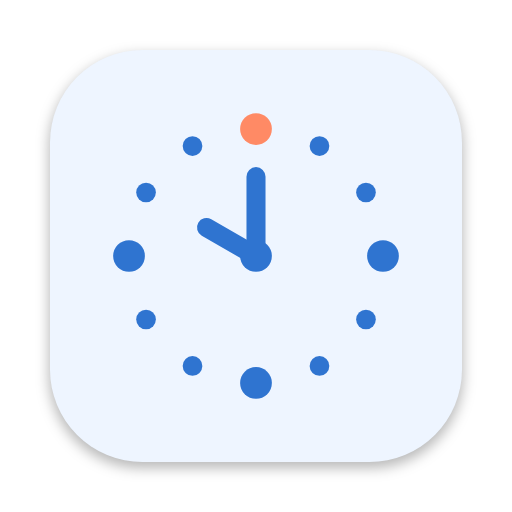
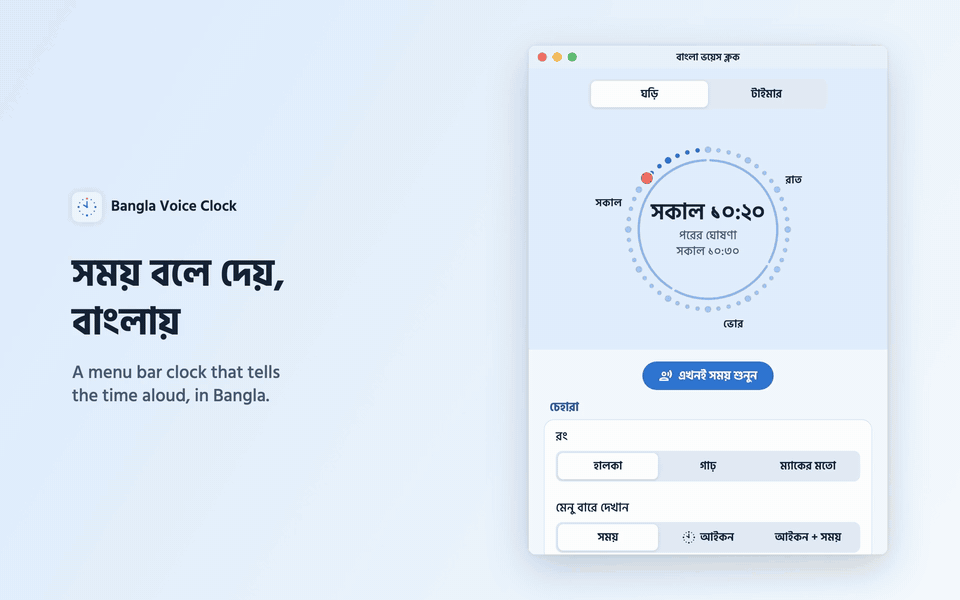
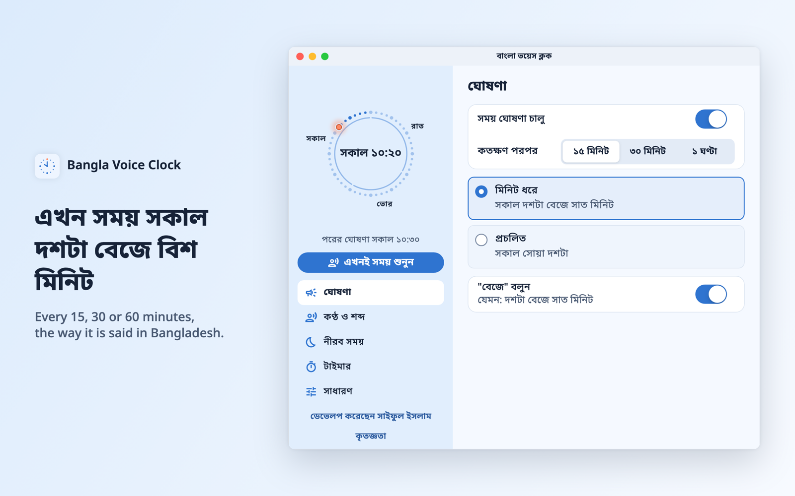
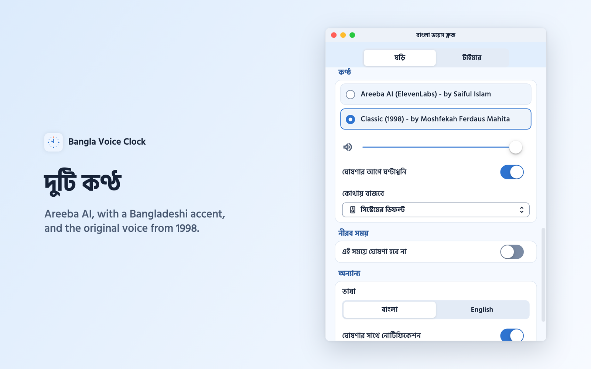
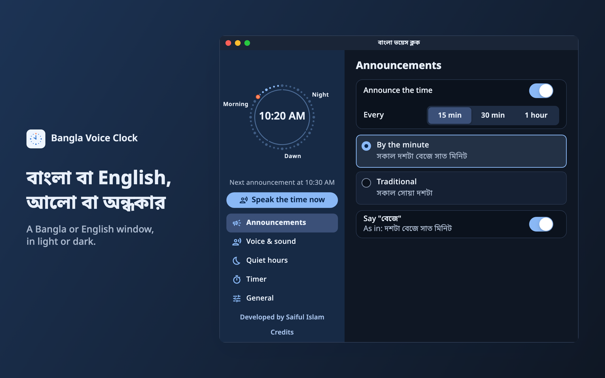
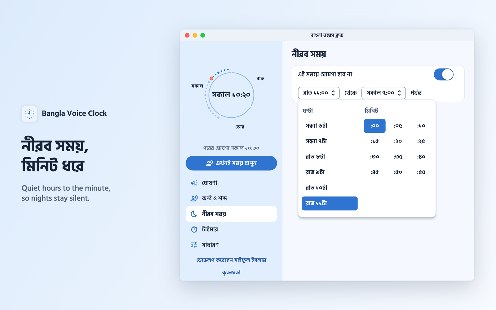
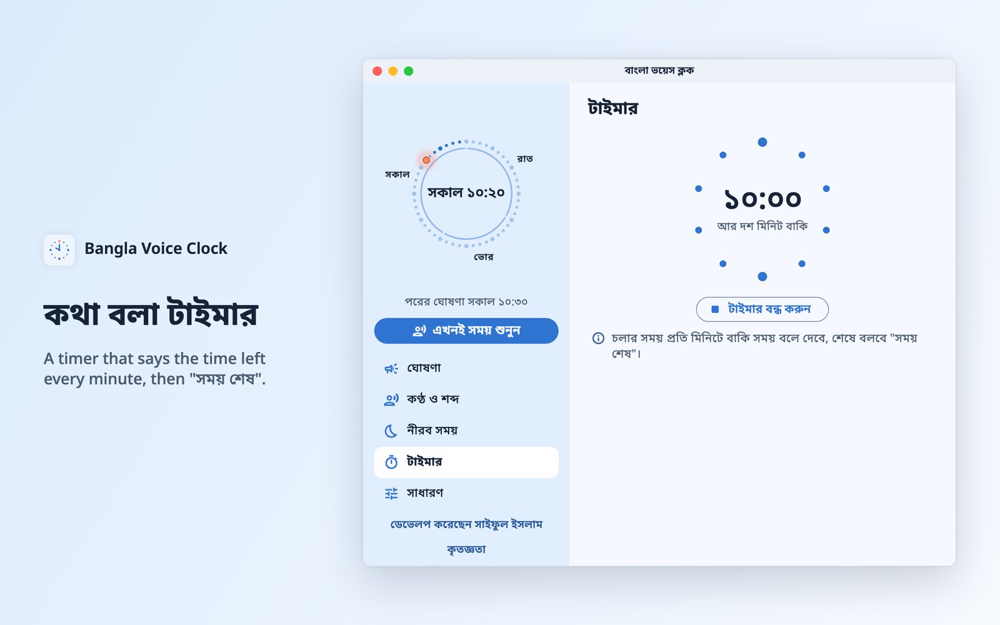
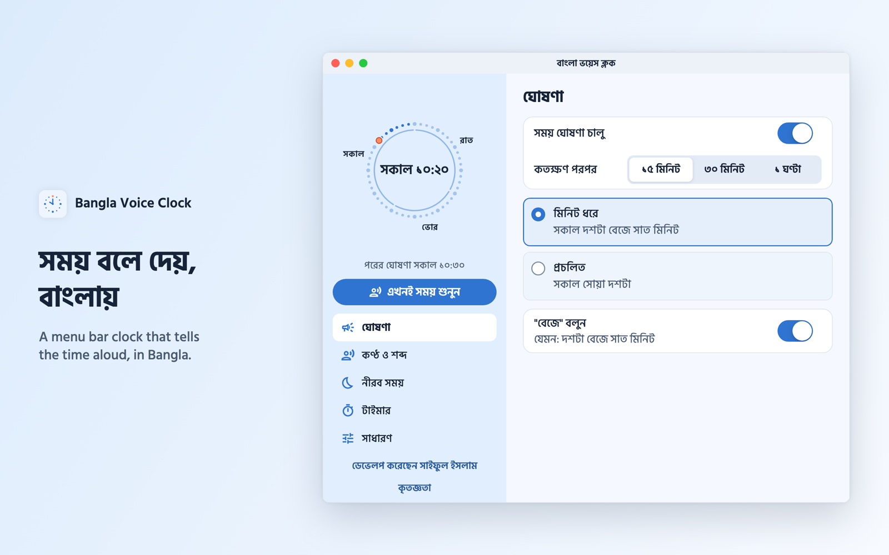

<p align="center">
  
</p>

<h1 align="center">Bangla Voice Clock</h1>

<p align="center">
  <b>বাংলা ভয়েস ক্লক</b><br>
  A free talking clock that tells the time aloud in Bangla, the way it is said in Bangladesh.
</p>

<p align="center">
  <a href="https://github.com/saifulmd0/bangla-voice-clock/releases"></a>
  <a href="https://github.com/saifulmd0/bangla-voice-clock/releases"></a>
  
  
  <a href="LICENSE"></a>
  <a href="https://github.com/saifulmd0/bangla-voice-clock/actions/workflows/ci.yml"></a>
</p>

<p align="center">
  <a href="https://github.com/saifulmd0/bangla-voice-clock/releases"></a>
  <a href="https://github.com/saifulmd0/bangla-voice-clock/releases"></a>
  <a href="#linux"></a>
</p>

<p align="center">
  <a href="docs/media/demo.mp4"></a><br>
  <a href="docs/media/demo.mp4"><b>▶ Watch the demo with sound</b></a> (30 seconds, with the app's real voices)
</p>

> **এখন সময় সকাল দশটা বেজে বিশ মিনিট।**<br>
> Every 15, 30 or 60 minutes, from the menu bar on a Mac, the system tray on Windows or the
> panel on Linux.

## Contents

- [Features](#features)
- [Screenshots](#screenshots)
- [Install](#install): [macOS](#macos) · [Windows](#windows) · [Linux](#linux) · [Updating](#updating) · [Uninstalling](#uninstalling)
- [Using it](#using-it)
- [FAQ](#faq)
- [Privacy](#privacy)
- [Credits](#credits)
- [Licence](#licence)
- [Development](#development)

## Features

- **Speaks Bangla the Bangladeshi way.** The part of the day (ভোর, সকাল, দুপুর, বিকাল, সন্ধ্যা,
  রাত), the exact minute ("দশটা বেজে সাত মিনিট", with or without বেজে) or the traditional
  quarters (সোয়া, সাড়ে, পৌনে). Whole recorded phrases, not robotic stitched words.
- **Two voices.** *Areeba AI*, a soft voice with a Bangladeshi accent made with ElevenLabs, and
  *Classic (1998)*, the voice of the original Bangla Voice Clock, used with permission.
- **On your schedule.** Every 15, 30 or 60 minutes, with an optional chime and notification,
  and quiet hours set to the minute.
- **A talking timer.** Up to three hours. It says the time left every minute ("আর দশ মিনিট
  বাকি") and "সময় শেষ" at the end.
- **Plays where you want.** The system default, the built-in speakers, headphones or any other
  output.
- **Stays out of the way.** It lives in the macOS menu bar (time, icon or both), the Windows
  system tray or the Linux panel, opens at login, and has no Dock or taskbar window.
- **Everything on one screen.** The clock and its dial of the day stay on the left; the five
  sections (announcements, voice and sound, quiet hours, timer, general) open beside it, with
  nothing to scroll. In Bangla or English, light or dark.
- **Free and open source, with no ads and no account.** Announcements work offline. It checks GitHub once a
  day for a new version, and you can turn that off.

## Screenshots

| | |
|---|---|
|  |  |
|  |  |
|  |  |

## Install

Get the latest version from **[Releases](https://github.com/saifulmd0/bangla-voice-clock/releases)**.
Each release has a file for each system:

| File | For |
|---|---|
| `BanglaVoiceClock-…-macos.dmg` | macOS 12 Monterey or later. One universal app for Apple Silicon and Intel |
| `BanglaVoiceClock-…-windows-setup.exe` | Windows 10 or 11, 64-bit (recommended) |
| `BanglaVoiceClock-…-windows-portable.zip` | Windows, without installing |
| `BanglaVoiceClock-…-linux-amd64.deb` | Ubuntu 22.04 or later, Debian 12 or later, Linux Mint 21 or later (64-bit) |
| `BanglaVoiceClock-…-linux.flatpak` | Any Linux with Flatpak, until it is on Flathub |
| `BanglaVoiceClock-…-linux-x64.tar.gz` | Any 64-bit Linux, without installing |

The apps are not code-signed yet, so macOS and Windows warn the first time. The steps below get
past that.

### macOS

**With [Homebrew](https://brew.sh)** (the easiest, and it skips the security warning):

```sh
brew install --cask saifulmd0/tap/bangla-voice-clock
```

**Or with the disk image:**

1. Download `BanglaVoiceClock-…-macos.dmg` and open it.
2. Drag **Bangla Voice Clock** onto **Applications**.
3. Open it from Applications. If macOS says it can't check the app, open **System Settings →
   Privacy & Security**, scroll down and choose **Open Anyway**. (On macOS 14 or older,
   right-click the app and choose **Open**.) You only do this once.
4. The time appears in the menu bar, and the settings window opens.

### Windows

1. Download `BanglaVoiceClock-…-windows-setup.exe` and run it.
2. If SmartScreen says "Windows protected your PC", choose **More info → Run anyway**.
3. Choose whether it starts when you sign in and whether to add a desktop shortcut (both are
   ticked), then **Install**. It installs for your account only, with no administrator prompt.
4. The clock icon appears in the system tray (in the **^** overflow at first; drag it onto the
   taskbar to keep it in view). Click it for the menu.

Prefer not to install? Unzip `BanglaVoiceClock-…-windows-portable.zip` anywhere and run
`BanglaVoiceClock.exe`.

### Linux

**Ubuntu, Debian and Linux Mint:** download `BanglaVoiceClock-…-linux-amd64.deb`, then open it
(App Center or the Software Manager installs it) or run:

```sh
sudo apt install ./BanglaVoiceClock-*-linux-amd64.deb
```

**Any distribution, with Flatpak:** download `BanglaVoiceClock-…-linux.flatpak`, then:

```sh
flatpak install --user ./BanglaVoiceClock-*-linux.flatpak
```

It needs the Flathub remote for its runtime, which most distributions have (if not:
`flatpak remote-add --user --if-not-exists flathub https://dl.flathub.org/repo/flathub.flatpakrepo`).
The app is on its way to [Flathub](https://flathub.org), after which it installs from GNOME
Software or Discover with one click and updates on its own.

**Without installing:** extract `BanglaVoiceClock-…-linux-x64.tar.gz` and run
`bangla-voice-clock/bangla-voice-clock`. It needs `libayatana-appindicator3-1` and `libpulse0`,
which Ubuntu and Mint have.

Open **Bangla Voice Clock** from the app menu. The clock icon appears in the panel, with the time
beside it on Ubuntu and GNOME; click it for the menu. Plain GNOME (Debian, Fedora) shows panel
icons only with the [AppIndicator extension](https://extensions.gnome.org/extension/615/appindicator-support/):
the `.deb` installs it, and **সাধারণ** (General) in the window offers to turn it on, after which
the icon and time sit in the top bar as in the Mac menu bar. Until then, closing the window keeps
the clock running out of sight; open the app again to bring the window back.

### Updating

Once a day the clock looks for a new version and, when there is one, shows what changed.

- **Windows (installed with the setup):** choose **Update now**. It downloads the new version,
  checks it, installs it and reopens the clock, keeping your settings.
- **macOS:** run `brew upgrade --cask bangla-voice-clock`, or choose **Open download page** and
  install the new disk image over the old app.
- **Windows portable:** download the new zip and replace the old folder.
- **Linux:** the `.deb` copy offers the new version's download page; install the new `.deb` over
  the old one. The Flatpak leaves updates to Flathub (`flatpak update`) and doesn't check itself.

You can also choose **Check for update now** under **General** (সাধারণ) in the window.

### Uninstalling

- **macOS:** quit it from its menu, then move the app from Applications to the Trash, or run
  `brew uninstall --cask bangla-voice-clock` (add `--zap` to remove its settings too).
- **Windows:** **Settings → Apps → Installed apps → Bangla Voice Clock → Uninstall**. For the
  portable copy, quit it from the tray and delete the folder.
- **Linux:** turn off opening at login first, then quit it and run
  `sudo apt remove bangla-voice-clock` or `flatpak uninstall io.github.saifulmd0.BanglaVoiceClock`,
  or delete the extracted folder.

## Using it

Click the time in the menu bar (the tray icon on Windows, the panel icon on Linux) for the menu:

- **এখনই সময় শুনুন** (Speak the time now)
- **ঘোষণা বন্ধ** (Mute), and **কতক্ষণ পরপর** (Every) 15 minutes, 30 minutes or 1 hour
- **সেটিংস…** (Settings…), **কৃতজ্ঞতা…** (Credits…) and **বন্ধ করুন** (Quit)

The window shows the dial of the day and **এখনই সময় শুনুন** on the left, above five sections:

- **ঘোষণা (Announcements):** on or off, how often, by the minute or traditional, and বেজে.
- **কণ্ঠ ও শব্দ (Voice & sound):** the voice, volume, chime and the output device.
- **নীরব সময় (Quiet hours):** when to stay silent, to the minute.
- **টাইমার (Timer):** pick the minutes and start; it speaks the time left every minute.
- **সাধারণ (General):** the language, light or dark, what the menu bar or panel shows,
  notifications, opening at login and update checks.

In a narrow window the sections become tabs along the top.

## FAQ

**Does it need the internet?**
No. Announcements and the timer work offline. The only connection is a once-a-day check of this
project's GitHub releases, which you can turn off under General ("নতুন সংস্করণ এলে জানান").

**I hear nothing.**
Choose **এখনই সময় শুনুন** (Speak the time now). If that is silent, check the volume slider and
**কোথায় বাজবে** (Play through) under Voice, and that the system volume is up. If only the
scheduled announcements are missing, check that announcements are on, not muted from the menu,
and not inside your quiet hours.

**Why does macOS or Windows warn about the app?**
The builds are not signed with a paid Apple or Microsoft developer certificate yet. The app is
built from this repository's source by [GitHub Actions](https://github.com/saifulmd0/bangla-voice-clock/actions),
and the release page lists each file's SHA-256.

**Why does the classic voice not say every minute?**
The 1998 recordings only cover the quarter hours, so with that voice the clock speaks the
traditional way. Areeba AI says any minute.

**There's no clock icon in the Linux panel.**
GNOME shows panel icons only with the
[AppIndicator extension](https://extensions.gnome.org/extension/615/appindicator-support/), which
Ubuntu includes and turns on. On Debian, Fedora and other plain GNOME, open **সাধারণ** (General)
in the window: it turns the extension on, or shows the command that installs it
(`sudo apt install gnome-shell-extension-appindicator` on Debian). An extension installed after
you logged in starts at the next login. The Flatpak can't do this itself; install the extension
with the Extension Manager app. KDE, Cinnamon, MATE, Xfce and Budgie show the icon as they are.

**Where are my settings?**
macOS: `~/Library/Containers/com.projuktiteam.banglaVoiceClock/Data/Library/Application Support/Bangla Voice Clock/settings.json`.
Windows: `%APPDATA%\Bangla Voice Clock\settings.json`.
Linux: `~/.config/bangla-voice-clock/settings.json`, or for the Flatpak
`~/.var/app/io.github.saifulmd0.BanglaVoiceClock/config/bangla-voice-clock/settings.json`.
Updates keep them.

**Is there an Android or iPhone version?**
Not yet. A mobile app for blind and low-literacy users is planned.

**Found a bug or have an idea?**
[Open an issue](https://github.com/saifulmd0/bangla-voice-clock/issues).

## Privacy

The app has no accounts, ads, analytics or tracking. Your settings stay on your computer. The
Flatpak has no network access at all. The
update check asks GitHub for the list of releases; GitHub sees the app's version and your IP
address, as with any web request, and nothing else is sent.

## Credits

- The original **Bangla Voice Clock** for Windows (1998–2002) by **Q A M Khaled Ferdaus**, of
  which this app is the successor.
- **Classic (1998)** voice by **Moshfekah Ferdaus Mahita**, from the original app, used with
  permission.
- **Areeba AI** voice by Saiful Islam, designed and generated with [ElevenLabs](https://elevenlabs.io).
- [Schedule Voice Clock](https://github.com/HridoyVaraby/schedule-voice-clock) by Hridoy
  Varaby, which inspired recording whole phrases.
- Built with [Flutter](https://flutter.dev); [Noto Sans Bengali](https://fonts.google.com/noto/specimen/Noto+Sans+Bengali) by Google for the text.

Developed by **[Saiful Islam](https://github.com/saifulmd0)**.

## Licence

Bangla Voice Clock is free and open source under the
[GNU General Public License, version 3 or later](LICENSE): you may use, study, share and change
it, and anything you share that is built on it must keep the credit and stay open source under
the same licence.

The Classic (1998) voice is the exception: those recordings are included with permission and are
not under the GPL. Noto Sans Bengali is under the SIL Open Font License. See [NOTICE.md](NOTICE.md).

## Development

Requires [Flutter](https://flutter.dev) 3.47.

```sh
flutter pub get
flutter test      # runs without Xcode
flutter analyze
```

Building and running the apps locally needs Xcode (macOS), Visual Studio (Windows) or, on Linux:

```sh
sudo apt install clang cmake ninja-build pkg-config libgtk-3-dev \
    libayatana-appindicator3-dev libpulse-dev
flutter build linux --release && tool/linux/package.sh   # tarball and .deb
```

Without them, push to GitHub and let CI build them all, including the Flatpak. Publishing on
Flathub is described in [docs/FLATHUB.md](docs/FLATHUB.md).

### Hearing the announcement engine

The engine runs from the command line, without the app:

```sh
# Speak a time (24-hour) with a voice pack folder; macOS plays it with afplay
dart run tool/speak.dart --pack assets/voices/bn_classic --time 10:15
dart run tool/speak.dart --pack assets/voices/bn_ai --time 21:27 --exact

# Convert a voice made for the original Windows app (VClock.def + vclock.wav)
dart run tool/import_legacy_voice.dart VClock.def vclock.wav <out-dir>
```

### Voices

| Pack | Voice |
|---|---|
| `bn_classic` | Moshfekah Ferdaus Mahita, from the original Bangla Voice Clock (1998). Used with permission. |
| `bn_ai` | A soft, cute young woman with a Bangladeshi accent, an AI voice designed with [ElevenLabs](https://elevenlabs.io). See [docs/VOICES.md](docs/VOICES.md). |

A pack records single words, which can say any time, plus whole phrases, which sound more
natural and are used whenever they match. `lib/core/speech/voice_script.dart` lists every line.

To make an AI pack, put `ELEVENLABS_API_KEY=...` in a `.env` file (git ignores it), then:

```sh
dart run tool/elevenlabs.dart design          # three preview voices to listen to
dart run tool/elevenlabs.dart save --id <generated_voice_id>
dart run tool/elevenlabs.dart generate --voice <voice_id> --out assets/voices/bn_ai
dart run tool/elevenlabs.dart check --pack assets/voices/bn_ai   # speech-to-text check
dart run tool/review_pack.dart --pack assets/voices/bn_ai        # long files to listen through
```

Add `--dry-run` to `generate` to list the lines and character count without calling the API.
Packs built from material we can't redistribute go in `voices_local/`, which git ignores.
